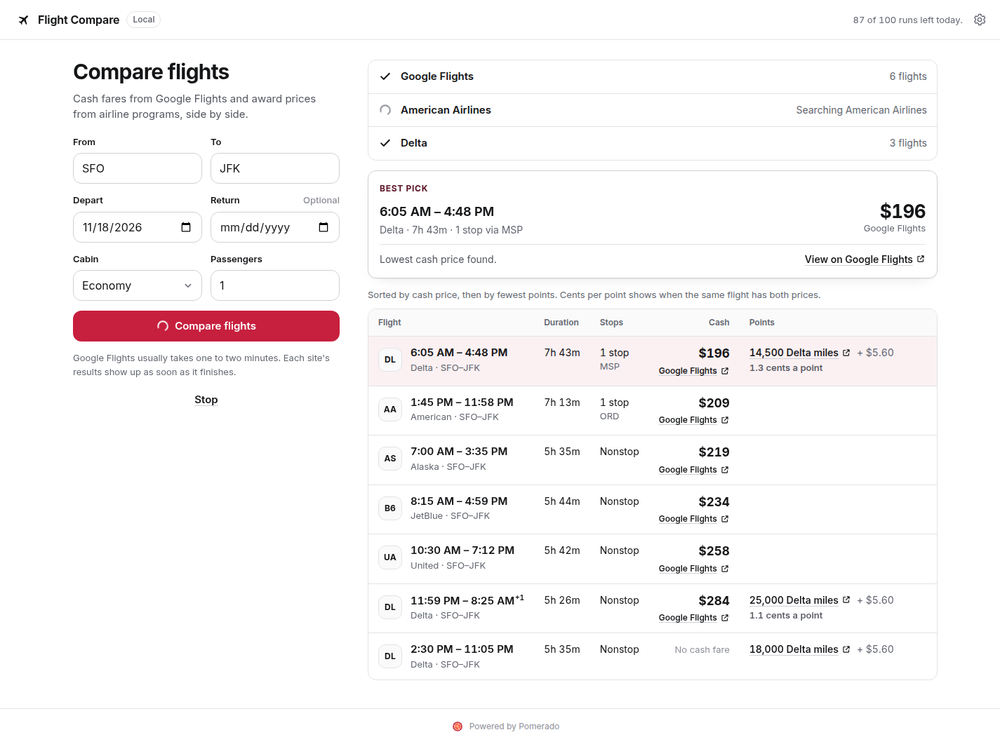

# Flight Compare

Cash fares from Google Flights and award prices from airline programs, side by side. A free
desktop app for macOS and Windows that runs on your own [Pomerado](https://pomerado.ai) account.



- Searches Google Flights for cash fares and American and Delta for award prices at the same time.
- Shows each site's results as soon as that site finishes.
- Lines up the same flight across sites, so a cash fare and its award price sit on one row.
- Shows cents per point when a flight has both prices for the same trip.
- Opens every result on its source site, so you can check it and book it there.

## Download

Get the latest `.dmg` (macOS) or `.exe` (Windows) from this repository's Releases page.

The downloads are not signed with a developer certificate, because the app is open source and
free. Your computer warns you the first time you open it.

### Open it on a Mac

1. Open the `.dmg` and drag Flight Compare into Applications.
2. Open Flight Compare. macOS says it can't check the app. Click Done.
3. Open System Settings, then Privacy & Security.
4. Scroll to Security. Next to the message about Flight Compare, click Open Anyway.
5. Confirm with your password or Touch ID, then click Open.

macOS remembers this, so the warning shows only once. On macOS 14 or earlier you can instead
Control-click the app in Applications, choose Open, then click Open.

If macOS says the app is damaged, run this once in Terminal, then open it again:

```sh
xattr -dr com.apple.quarantine "/Applications/Flight Compare.app"
```

### Open it on Windows

1. Run the installer.
2. Windows SmartScreen says it protected your PC. Click More info.
3. Click Run anyway.

The zip download runs without installing. Unzip it and open `Flight Compare.exe`, then follow the
same two clicks.

## First run

Flight Compare runs its searches on your own Pomerado account. Setup takes about two minutes.

1. Create a free Pomerado account. The free plan includes 100 runs a day.
2. Make a key. The app opens Pomerado's key form already filled in. Click Create and copy the key.
3. Paste the key into the app.

Each site in a search uses one run. When you run out, the app says when your runs come back and
links to Pomerado Premium, which gives you 1,000 runs a day.

## How your key is kept

- The key is encrypted with your system keychain (Electron `safeStorage`) and never written in
  plain text. On Linux without a keychain, it stays in memory until you close the app.
- Only the app's main process holds the key and calls Pomerado. The window gets job handles, never
  the key or job ids.
- The app only starts read-only runs (`POST /v1/runs/read-only`), so it never changes a website.
- Settings, then Disconnect, deletes the key.

## How results are ranked

One visible rule, with no hidden scoring:

- Flights with a cash fare come first, lowest fare first.
- Flights with only an award price follow, fewest points first.
- Ties go to fewer stops, then shorter flights, then earlier departures.
- The best pick is the lowest cash fare. A second pick shows the flight whose points go furthest.
- Every price is a total for all passengers. Google Flights quotes the whole party; award sites
  quote miles and taxes per passenger, which the app multiplies by the passenger count.
- Cents per point is `(cash fare - award taxes) / points`, shown only when both prices are for the
  same one-way trip and the taxes are in the fare's currency.
- With a return date, every site lists outbound flights with a starting price for the whole round
  trip, and no return flight is picked yet. The app labels these "Round trip" and shows no cents
  per point. American states each row's price scope; a one-way scope is labelled "Outbound only".

## Sites

The sites are public Pomerado tools, listed in [`src/shared/tools.ts`](src/shared/tools.ts). Each
has a one-way tool and a round-trip tool. United's award search is in the list but turned off
while its tool is rebuilt. It needs a United login, which the run asks for on Pomerado's own page.

Each tool has its own result shape. [`src/shared/flights.ts`](src/shared/flights.ts) has one
normalizer per tool, written against that tool's `output_schema` from `GET /v1/tools/{id}`.

## Development

Flight Compare is built on [pomerado-app-kit](https://github.com/Pomerado/pomerado-app-kit),
which it expects in a sibling folder for now.

```sh
git clone https://github.com/Pomerado/pomerado-app-kit
git clone https://github.com/Pomerado/flight-compare
(cd pomerado-app-kit && npm install && npm run build)
cd flight-compare
npm install
npm run dev
```

Node 22.12 or later. Electron downloads on first launch.

### Without an account

`npm run fake-api` starts a local stand-in for Pomerado's API with made-up results. In the app's
Settings, set the API address to `http://127.0.0.1:4010/v1`, then connect with the key it prints.

To point the app at another Pomerado environment, change the API and Dashboard addresses in
Settings. Changing the API address disconnects your key.

### Tests

```sh
npm run typecheck
npm run test:unit      # normalizers and ranking
npm run test:e2e       # the built app, driven by Playwright against the fake API
npm run screenshots    # docs/screenshots at 390 and 1440 px wide
```

On Linux without a display, run the Playwright commands under `xvfb-run -a`.

### Release builds

Pushing a tag such as `v0.1.0` runs [`.github/workflows/release.yml`](.github/workflows/release.yml),
which builds the macOS (`dmg`, `zip`) and Windows (`nsis`, `zip`) downloads without a developer
certificate and attaches them to a draft release. The Mac app gets only the ad-hoc signature that
Apple Silicon needs to run it at all. Locally, `npm run dist:mac` or `npm run dist:win`.

## Layout

| Path | What it holds |
|---|---|
| `src/main` | Electron main process: the window and the kit's Pomerado bridge |
| `src/preload` | Exposes `window.pomerado` to the window |
| `src/renderer` | The screen: form, site status, best pick, table and cards |
| `src/shared/copy.ts` | Every word the app shows |
| `src/shared/tools.ts` | Sites and their tool ids |
| `src/shared/flights.ts` | Each site's result as one `FlightOption` shape |
| `src/shared/rank.ts` | Lining up and ranking |
| `test/fake-api` | The local stand-in for Pomerado's API |

## License

MIT
